# Manual de usuario

**Sistema Web de Gestión y Control de Inventario — Laboratorio Privado Quetzaltenango**
Versión 1.1 · Entrega 4 · octubre de 2026 (interfaz con el diseño de SIGAL)

Este manual explica cómo usar el sistema en el trabajo diario del laboratorio: registrar lo que entra y sale de bodega, saber qué hay, qué se está acabando y qué está por vencer, y sacar reportes. Está escrito para el personal del laboratorio; no hace falta saber de computación ni de bases de datos.

Cada procedimiento tiene un código (**U-01**, **U-02**…). El mismo código aparece en los casos de prueba de la Entrega 4 (`docs/casos-prueba/casos-prueba-entrega-4.md`), donde consta que el flujo se ejecutó tal como se describe aquí. Las imágenes son capturas de esa ejecución.

---

## Contenido

1. [Antes de empezar](#1-antes-de-empezar)
2. [Entrar, salir y cambiar la contraseña](#2-entrar-salir-y-cambiar-la-contraseña) — U-01, U-02
3. [El Panel y la búsqueda rápida](#3-el-panel-y-la-búsqueda-rápida)
4. [Registrar y corregir una entrada](#4-registrar-una-entrada) — U-03, U-13
5. [Registrar una salida (consumo)](#5-registrar-una-salida) — U-04
6. [Corregir una salida mal registrada (devolución)](#6-corregir-una-salida-mal-registrada-devolución) — U-05
7. [Consultar lotes, existencias y vencimientos](#7-consultar-lotes-existencias-y-vencimientos) — U-06
8. [Reportes](#8-reportes) — U-07
9. [Productos y categorías](#9-productos-y-categorías) — U-08
10. [Proveedores y sus precios](#10-proveedores-y-sus-precios) — U-09
11. [Exámenes y los insumos que consumen](#11-exámenes-y-los-insumos-que-consumen) — U-10
12. [Usuarios y roles](#12-usuarios-y-roles) — U-11
13. [Respaldo de la información](#13-respaldo-de-la-información) — U-12
14. [Mensajes del sistema y qué hacer](#14-mensajes-del-sistema-y-qué-hacer)
15. [Preguntas frecuentes](#15-preguntas-frecuentes)

---

## 1. Antes de empezar

### Qué se necesita

- Una computadora, tableta o celular con un navegador actualizado (Edge, Chrome, Firefox o Safari).
- La dirección del sistema: **https://inventario-laboratorio-03s7.onrender.com**
- Un usuario y una contraseña, que entrega el administrador del sistema.

> El servicio gratuito donde está publicado el sistema se "duerme" tras 15 minutos sin uso. La primera vez que se abre después de eso tarda alrededor de 50 segundos en cargar; luego funciona con normalidad.

### Los tres roles

Cada usuario tiene un rol, y el rol decide qué puede hacer. El menú solo muestra lo que el rol permite, y si alguien escribe a mano la dirección de una pantalla que no le corresponde, el sistema responde **"Acceso no permitido"**.

| Puede… | Administrador | Encargado de inventario | Usuario de consulta |
|---|:---:|:---:|:---:|
| Consultar inventario, lotes, movimientos y reportes | ✔ | ✔ | ✔ |
| Cambiar su propia contraseña | ✔ | ✔ | ✔ |
| Registrar entradas, salidas y devoluciones | ✔ | ✔ | — |
| Crear y editar productos, categorías, proveedores y exámenes | ✔ | — | — |
| Corregir una entrada mal digitada, o el número o el vencimiento de un lote | ✔ | — | — |
| Administrar usuarios y descargar el respaldo | ✔ | — | — |

### Cómo está organizada la pantalla

A la izquierda está el **menú**, sobre fondo oscuro y agrupado por tarea:

- **Operación:** Panel, Movimientos, Lotes y Reportes. Es lo que se usa todos los días.
- **Catálogos:** Productos, Exámenes, Proveedores y Categorías.
- **Administración** (solo el administrador): Usuarios y roles, y Respaldo.

La opción en la que está aparece resaltada, con su ícono en ámbar. Abajo del menú, el punto verde **Conectado** indica que el sistema responde.

Arriba está la **barra superior**:

| Elemento | Para qué sirve |
|---|---|
| **Buscar producto o pantalla** (o las teclas `Ctrl` + `K`) | Ir directo a una pantalla o al kardex de un producto escribiendo parte de su nombre o código (sección 3) |
| **Sol / luna** | Cambiar entre tema claro y oscuro. El navegador lo recuerda |
| **Su nombre y rol** (con sus iniciales en un círculo) | Abre el menú de usuario: **Cambiar mi contraseña** y **Cerrar sesión** |

Los avisos del sistema aparecen como **notificaciones flotantes** en la esquina inferior derecha. Un punto **verde** indica que algo se guardó (el aviso se retira solo); uno **rojo**, que algo no se pudo hacer y por qué (se queda hasta que lo cierre con la **×**).

En el celular, el menú se esconde: se abre con el botón de las tres rayas, arriba a la izquierda.

---

## 2. Entrar, salir y cambiar la contraseña

### U-01 Iniciar y cerrar sesión

1. Abra la dirección del sistema. Aparece la pantalla de ingreso.
2. Escriba su **usuario** y su **contraseña** y presione **Entrar**.
3. Si los datos son correctos, entra al **Panel**. Si no, aparece *"Usuario o contraseña incorrectos."* El mensaje es el mismo si el usuario no existe o si la contraseña está mal: así nadie puede averiguar qué usuarios existen.
4. Para terminar, abra el **menú de usuario** (su nombre, arriba a la derecha) y elija **Cerrar sesión**. Aparece *"Sesión cerrada."*

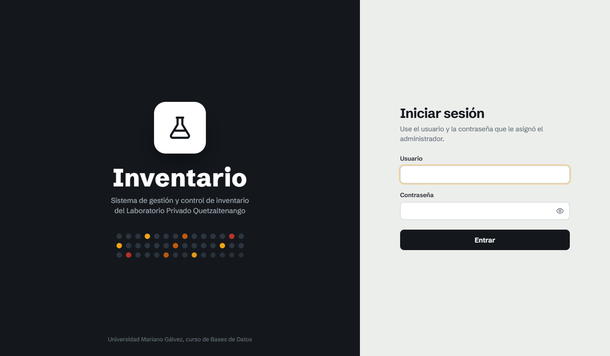

Cierre la sesión siempre que deje la computadora, sobre todo si es compartida.

### U-02 Cambiar mi contraseña

Cualquier usuario puede cambiar su contraseña cuando quiera. Se recomienda hacerlo la primera vez que entra con la contraseña que le dio el administrador.

1. Abra el **menú de usuario** (su nombre, arriba a la derecha) y elija **Cambiar mi contraseña**.
2. Escriba su **contraseña actual**.
3. Escriba la **nueva contraseña** (mínimo 8 caracteres) y repítala.
4. Presione **Cambiar contraseña**. Aparece *"Contraseña cambiada. Úsela la próxima vez que inicie sesión."*

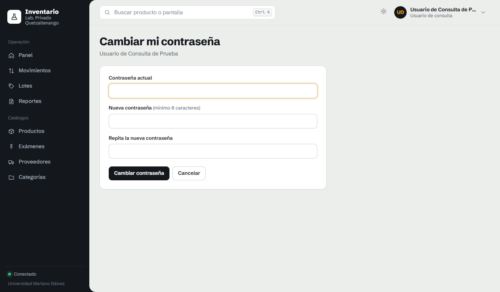

El sistema no acepta el cambio si la contraseña actual es incorrecta, si la nueva tiene menos de 8 caracteres, si la confirmación no coincide o si la nueva es igual a la anterior. Si olvidó su contraseña, pida al administrador que le asigne una nueva (sección 12).

---

## 3. El Panel y la búsqueda rápida

### El Panel ("Bodega hoy")

Es la primera pantalla después de entrar. Muestra en un vistazo el estado del inventario hoy.

**Franja de indicadores** (cada uno lleva a su detalle al hacer clic):

| Indicador | Qué significa |
|---|---|
| **Con existencias** | Cuántos productos activos tienen algo en bodega, de cuántos hay en el catálogo |
| **Valor en bodega** | Valor del inventario a costo promedio ponderado |
| **Vencen en 90 días** | Lotes con existencia que vencen pronto: conviene usarlos primero |
| **Bajo el mínimo** | Productos con existencia, pero en su stock mínimo o por debajo |
| **Agotados** | Productos que se usaban (tienen historial) y ya no tienen existencia |

**Calendario de vencimientos.** Cada punto es un lote con existencia, ubicado en el mes en que vence:
- **rojo:** ya venció; está en la columna *Vencidos* y hay que retirarlo;
- **naranja:** vence en 30 días;
- **ámbar:** vence en 90 días;
- **gris:** vence más adelante.

La columna del mes actual dice **hoy**. Al pasar el cursor sobre un punto (o tocarlo en el celular) aparece el producto, el lote, la fecha y la existencia. Al hacer clic, se abre la ficha del lote.

**Reponer primero.** Los productos bajo su mínimo, primero los agotados y luego los que más se consumieron en los últimos 60 días, con un cálculo de para cuántos días alcanza lo que queda.

**Actividad reciente.** Las entradas (↓), salidas (↑) y devoluciones (↩) de los últimos 14 días. Clic en una para ver su detalle.

El encargado y el administrador ven además los botones **Registrar salida** y **Registrar entrada**.

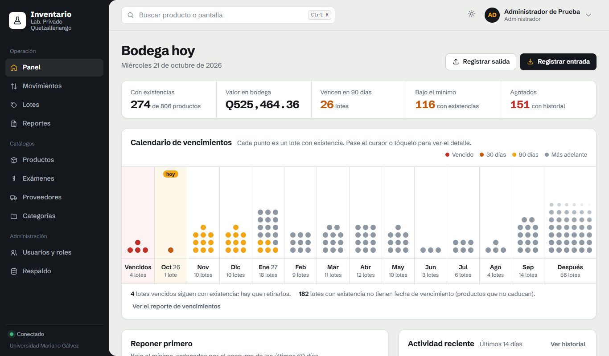

### Búsqueda rápida

Presione `Ctrl` + `K` (o haga clic en **Buscar producto o pantalla**) y escriba parte de un nombre o código:
- **Pantallas:** lleva a esa sección del menú.
- **Productos:** muestra su existencia y abre su kardex.

Muévase con las flechas, abra con `Enter` y cierre con `Esc`.

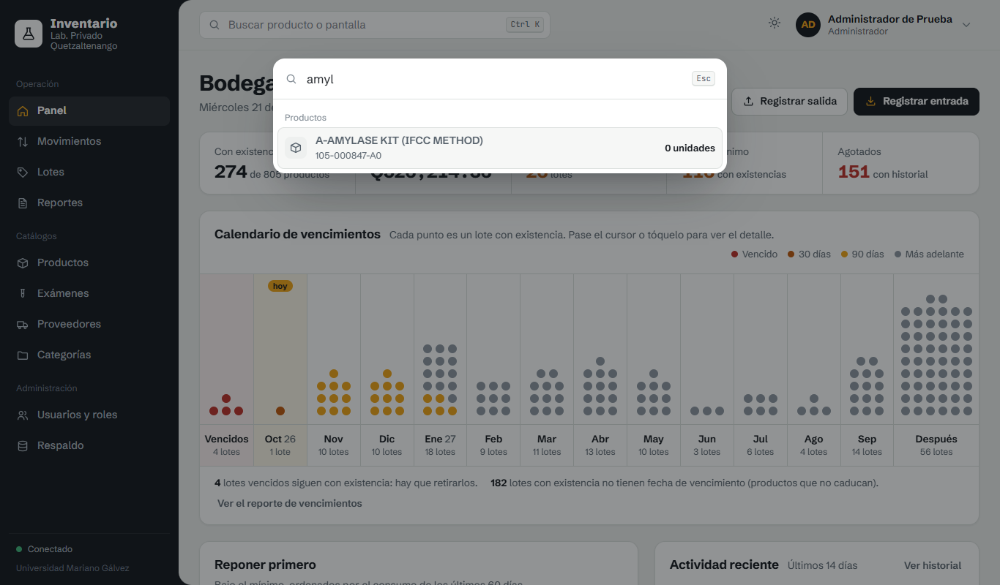

---

## 4. Registrar una entrada

Una **entrada** es todo lo que llega a la bodega: una compra, una donación, una reposición. Cada entrada crea un **lote** nuevo o suma a uno que ya existe.

*Roles: Administrador y Encargado de inventario.*

### U-03 Registrar una entrada

1. En el **Panel** presione **Registrar entrada** (o en **Movimientos**, el mismo botón).
2. **Producto:** empiece a escribir el nombre o el código y elíjalo de la lista que aparece.
3. **Proveedor:** elija quién lo entregó.
4. **Número de lote:** el que trae impreso el empaque. Si el producto ya tiene un lote con ese número, la cantidad se suma a ese lote.
5. **Fecha de vencimiento:** la del empaque. Es **obligatoria** para los productos marcados como "requiere vencimiento" (reactivos, por ejemplo); el sistema no deja registrar la entrada sin ella.
6. **Cantidad** y **precio unitario** de compra (en quetzales, hasta 2 decimales).
7. **Observación** (opcional): número de factura, quién recibió, etc.
8. Presione **Registrar entrada**. Aparece, por ejemplo, *"Entrada registrada: 20 de REACTIVO DE PRUEBA CP4B en el lote CP4B-A."* y se abre el detalle del movimiento.

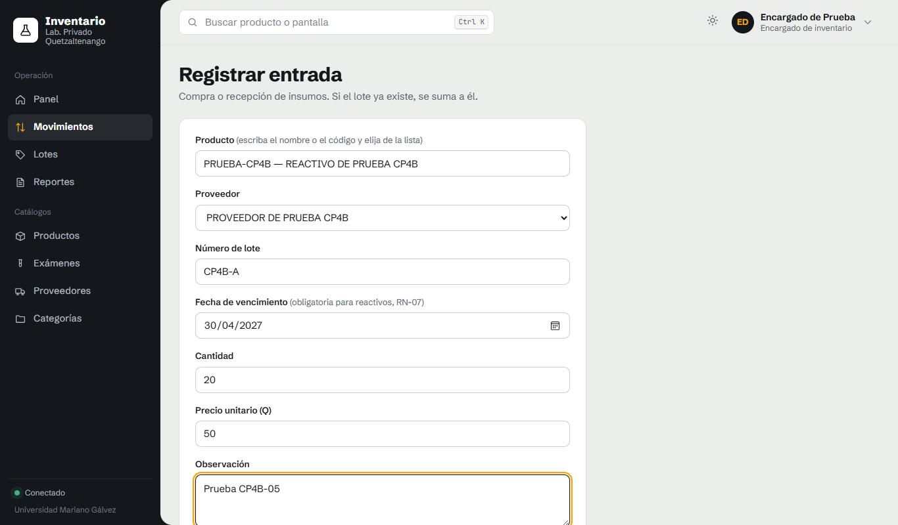

La existencia del lote sube automáticamente. La fecha, la hora y el nombre de quien registró quedan guardados.

### U-13 Corregir una entrada mal digitada

*Solo el Administrador.* Una entrada **no se elimina**; si tiene un dato equivocado (cantidad, precio, proveedor, número de lote o vencimiento), se **corrige**, y la corrección queda registrada.

1. Abra la entrada: **Movimientos → pestaña Entradas** → clic en su fecha.
2. Presione **Corregir entrada**. El formulario viene con los datos registrados.
3. Cambie solo lo que está mal.
4. **Motivo:** explique por qué (mínimo 10 caracteres), por ejemplo *"La factura dice 22 unidades y se digitó 20"*.
5. Presione **Guardar corrección**. Aparece *"Entrada #… corregida: 2 datos. El registro original y la corrección quedan en el historial."*

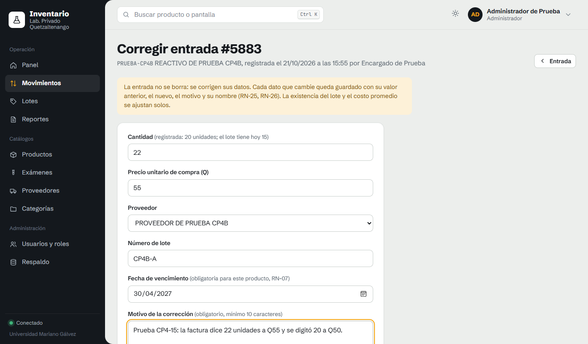

En la ficha de la entrada aparece la tabla **Correcciones**: cada dato corregido, con su valor anterior, el nuevo, el motivo, quién lo corrigió y cuándo. Esas filas no se pueden borrar.

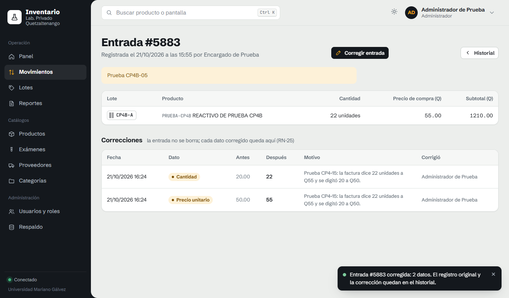

Qué hace el sistema por usted:
- La **existencia del lote** sube o baja por la diferencia. No deja bajar una entrada por debajo de lo que ya salió de ese lote; el mensaje dice el mínimo posible.
- El **kardex y el valor del inventario** se recalculan con el precio corregido.
- El **proveedor, el número de lote y el vencimiento** son datos del lote: si el lote recibió varias entradas, el formulario lo advierte, porque la corrección vale para todas.

No se corrige el **producto** de una entrada. Si se registró en el producto equivocado, registre una salida de ese producto y una entrada en el correcto, cada una con su observación.

---

## 5. Registrar una salida

Una **salida** es lo que se saca de bodega para usarse: reactivos para un examen, material para un área, etc.

*Roles: Administrador y Encargado de inventario.*

### U-04 Registrar una salida

1. En el **Panel** presione **Registrar salida**.
2. **Producto:** escríbalo y elíjalo de la lista. Debajo aparece la **existencia utilizable** (lo que hay en lotes no vencidos), para que sepa cuánto puede sacar.
3. **Cantidad** que sale.
4. **Observación** (opcional): para qué área o examen.
5. Presione **Registrar salida**.

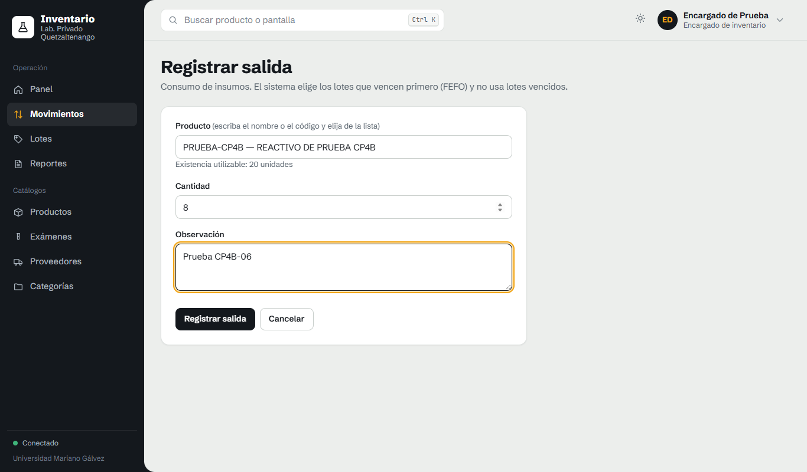

**Usted no elige el lote.** El sistema descuenta solo, empezando por el lote que **vence primero** (método FEFO: *first expired, first out*), y nunca toma unidades de lotes ya vencidos. Si la cantidad no alcanza en un lote, completa con el siguiente; el detalle de la salida muestra de qué lotes salió cada parte.

Si se pide más de lo que hay, la salida **no se registra** y aparece, por ejemplo: *"Existencia insuficiente de "CUVETTES FOR URISED": disponible 26.00 (sin contar lotes vencidos), solicitado 99999."*

---

## 6. Corregir una salida mal registrada (devolución)

Los movimientos **no se pueden editar ni borrar**: es lo que garantiza que el historial sea confiable. Si una salida se registró por error (otra cantidad, otro producto, un examen que se canceló), se corrige con una **devolución**, que repone las unidades al mismo lote del que salieron. La salida original no desaparece: ambos movimientos quedan en el historial, enlazados.

*Roles: Administrador y Encargado de inventario.*

### U-05 Devolver una salida

1. Abra la salida: **Movimientos → pestaña Salidas** → haga clic en la fecha de la salida (o desde *Actividad reciente* en el Panel).
2. Presione **Devolver esta salida**.
3. **Motivo:** explique por qué se devuelve (mínimo 10 caracteres). Es obligatorio y queda guardado.
4. **Cuánto devolver de cada lote:** viene propuesto el total que salió de cada lote. Bájelo si solo devuelve una parte, o déjelo en cero en los lotes que no devuelve.
5. Presione **Registrar devolución**. Aparece *"Devolución registrada: 3 devuelto a 1 lote(s). La salida #5884 queda corregida y ambos movimientos permanecen en el historial."*

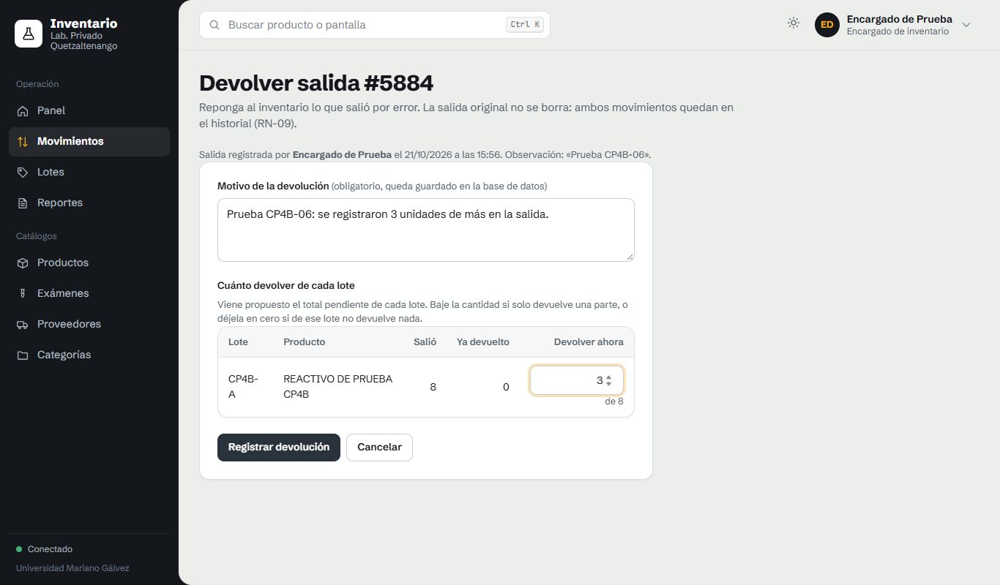

No se puede devolver más de lo que salió, ni devolver dos veces lo mismo: el sistema descuenta lo que ya se devolvió antes.

---

## 7. Consultar lotes, existencias y vencimientos

*Todos los roles.*

### U-06 Consultar un lote

1. En el menú, **Lotes**. Las pestañas separan los lotes **Con existencia**, los que **Vencen en 90 días**, los **Vencidos con existencia** y **Todos**.
2. Busque por producto, código o número de lote.
3. Haga clic en el número de lote para ver su ficha: existencia, vencimiento, proveedor, fecha de ingreso y **todos sus movimientos**, con el signo **+** para lo que entró o se devolvió y **−** para lo que salió.

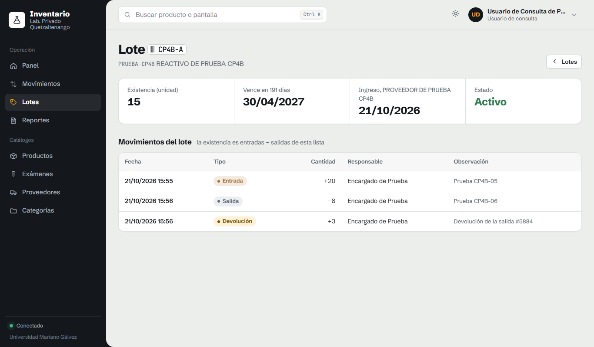

La existencia de un lote **nunca se escribe a mano**: siempre es el resultado de sus entradas, salidas y devoluciones. Por eso la ficha dice "la existencia es entradas – salidas de esta lista".

**Corregir datos de un lote** (solo administrador): en la ficha, **Corregir datos** permite corregir el número de lote o la fecha de vencimiento si se digitaron mal, o dar de baja el lote. La cantidad no se puede editar.

---

## 8. Reportes

*Todos los roles.*

### U-07 Generar un reporte

1. En el menú, **Reportes**.
2. Elija el tipo de reporte. Según el tipo, aparecen los filtros que aplican (período, categoría, producto, agrupación).
3. Presione **Generar reporte**.
4. En el reporte puede **Descargar CSV** (se abre en Excel con tildes correctas), **Imprimir** (sale sin menú ni botones, con el título y el período) o elegir **Otro reporte**.

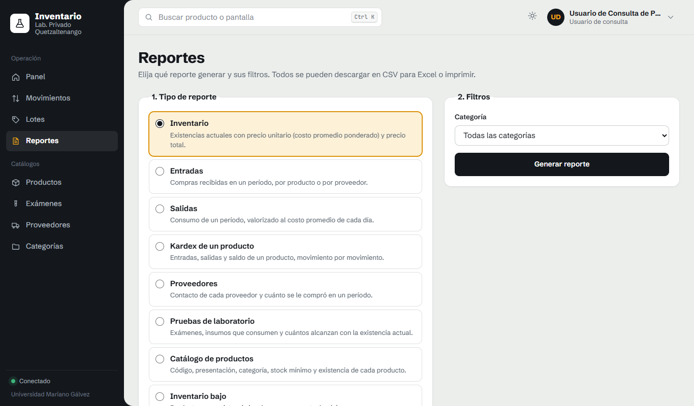

| Reporte | Para qué sirve |
|---|---|
| **Inventario** | Existencia actual de cada producto con su precio unitario y su valor total |
| **Entradas** | Lo que se compró en un período, por producto o por proveedor |
| **Salidas** | Lo que se consumió en un período, valorizado |
| **Kardex de un producto** | Cada entrada, salida y devolución de un producto, con el saldo después de cada una |
| **Proveedores** | Datos de contacto y cuánto se le compró a cada uno |
| **Pruebas de laboratorio** | Para cuántos exámenes alcanza la existencia actual y qué insumo los limita |
| **Catálogo de productos** | Código, presentación, categoría, stock mínimo y existencia |
| **Inventario bajo** | Productos en su stock mínimo o por debajo |
| **Vencimientos** | Lotes vencidos y por vencer |

**Cómo se valoriza el inventario.** El sistema usa el **costo promedio ponderado**: cada compra recalcula el costo promedio del producto, y cada salida se valora al promedio vigente ese día. Las devoluciones reingresan al mismo promedio al que salieron, así que no lo alteran. El kardex muestra este cálculo línea por línea.

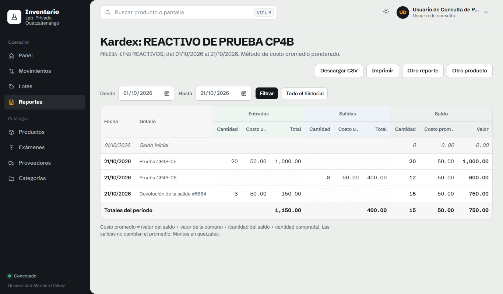

---

## 9. Productos y categorías

*Consultar: todos los roles. Crear, editar y desactivar: Administrador.*

### U-08 Crear un producto

1. En el menú, **Productos** → **Nuevo producto**.
2. Complete:
   - **Código:** único; el sistema avisa si ya existe.
   - **Nombre** y **descripción**.
   - **Categoría** (reactivos, material, etc.).
   - **Presentación:** unidad, caja, paquete, ml…
   - **Stock mínimo:** cuando la existencia llegue a este número, el producto aparece en *inventario bajo*.
   - **Requiere vencimiento:** márquelo para reactivos y todo lo que caduca. Así el sistema exigirá la fecha en cada entrada.
3. Presione **Guardar**. Aparece *"Producto creado correctamente."*

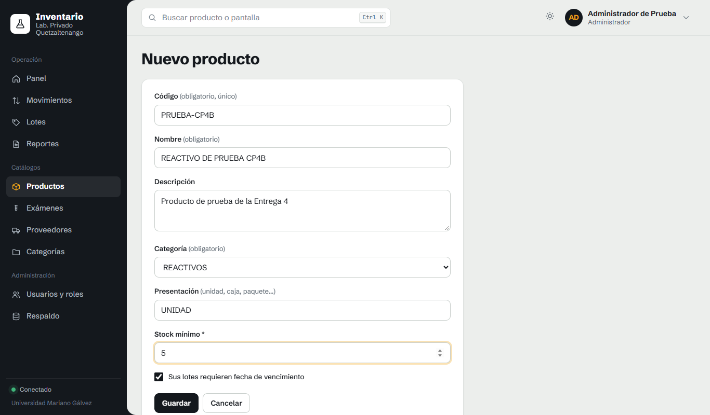

**Editar:** botón **Editar** en la fila del producto.
**Dar de baja:** botón **Desactivar**. El producto deja de ofrecerse en entradas y salidas, pero **conserva todo su historial**. Se puede volver a activar en cualquier momento. Los productos no se borran porque sus movimientos deben seguir siendo consultables.

**Categorías** funcionan igual: **Categorías → Nueva categoría**, **Editar** y **Desactivar**.

---

## 10. Proveedores y sus precios

*Consultar: todos los roles. Crear, editar, asignar productos y desactivar: Administrador.*

### U-09 Registrar un proveedor y los productos que suministra

1. **Proveedores → Nuevo proveedor.** Complete nombre, NIT (único), teléfono, correo y dirección, y presione **Guardar**.
2. En la lista, presione **Ver** en la fila del proveedor para abrir su ficha.
3. En **Asignar producto o cambiar precio**, escriba el producto, elíjalo de la lista, escriba el **precio de compra** acordado y presione **Guardar**.
4. Para **cambiar el precio** de un producto que ya está asignado, repita el paso 3 con el precio nuevo: reemplaza el anterior.
5. Para **quitar** un producto del proveedor, presione **Quitar** en su fila y confirme. Esto no afecta los lotes ni los movimientos ya registrados.

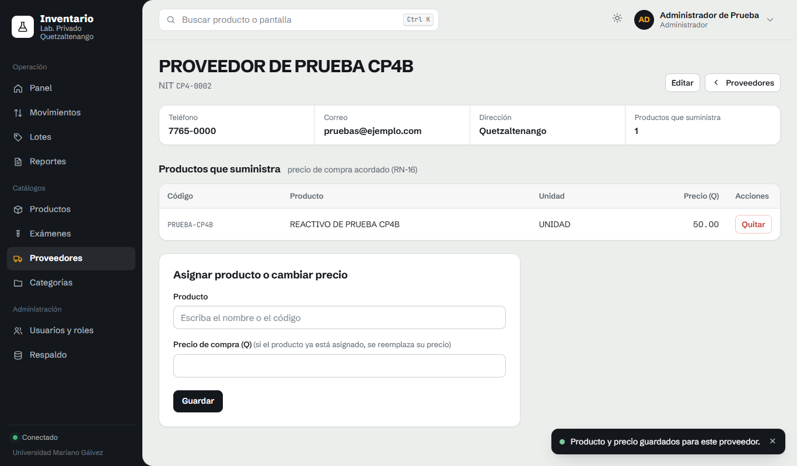

**Dar de baja un proveedor:** **Desactivar** en la lista. Deja de ofrecerse en las entradas nuevas y conserva su historial.

---

## 11. Exámenes y los insumos que consumen

*Consultar: todos los roles. Crear, editar, asignar insumos y dar de baja: Administrador.*

### U-10 Registrar un examen y sus insumos

1. **Exámenes → Nuevo examen.** Escriba el nombre, el código interno (letras, números y guiones, por ejemplo `EX-GLU-01`) y una descripción. Presione **Guardar**: se abre la ficha del examen.
2. En **Agregar insumo**, elija el producto y la **cantidad que consume cada examen**. Si un empaque rinde varias pruebas, use una fracción: por ejemplo, 0.01 si rinde 100.
3. Presione **Agregar**. La ficha calcula **para cuántos exámenes alcanza** la existencia actual y qué insumo es el que limita.
4. Para quitar un insumo, **Quitar** en su fila.

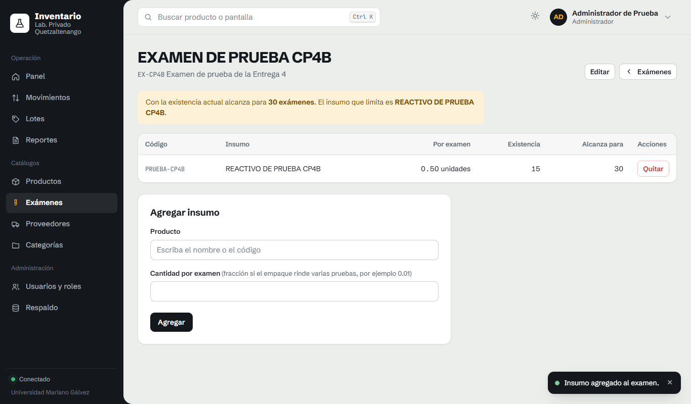

**Dar de baja un examen** que el laboratorio ya no ofrece: en la lista de exámenes, **Dar de baja**. El examen conserva su ficha y sus insumos, pero ya no aparece en el reporte *Pruebas de laboratorio*. **Activar** lo devuelve.

---

## 12. Usuarios y roles

*Solo Administrador.*

### U-11 Crear, modificar y desactivar un usuario

1. **Usuarios y roles → Nuevo usuario.**
2. Escriba el **nombre completo**, el **usuario** con el que entrará (minúsculas, números, punto o guion), el **rol** y una **contraseña** de al menos 8 caracteres (dos veces).
3. Presione **Crear usuario**. Entregue la contraseña a la persona por un medio privado y pídale que la cambie al entrar (U-02).

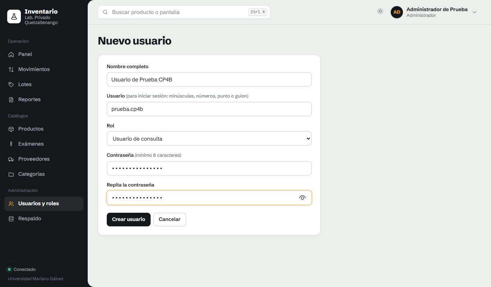

- **Cambiar el rol o asignar una contraseña nueva** (por ejemplo, si alguien la olvidó): **Editar** en la fila del usuario. Si deja la contraseña vacía, no se cambia.
- **Desactivar:** el usuario ya no puede entrar, pero sus movimientos siguen mostrando su nombre. No se puede desactivar a sí mismo ni cambiar su propio rol, y el sistema no permite dejar el sistema sin ningún administrador activo.

La misma pantalla muestra la tabla de permisos de cada rol.

---

## 13. Respaldo de la información

*Solo Administrador.*

### U-12 Descargar un respaldo

1. **Administración → Respaldo.** La pantalla muestra cuánta información contiene hoy el sistema.
2. Presione **Descargar respaldo**. El navegador guarda un archivo `respaldo_inventario_AAAAMMDD_HHMM.sql` con **todos** los datos: catálogos, lotes, el historial completo, exámenes y usuarios (las contraseñas van protegidas, nunca legibles).
3. Guarde el archivo **fuera del servidor**: una memoria USB, una unidad de red o la nube del laboratorio.

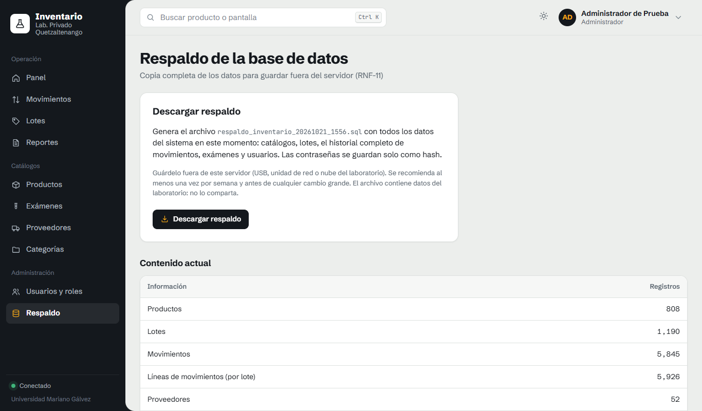

**Cada cuánto:** al menos una vez por semana y siempre antes de un cambio importante. Conserve varios respaldos (por ejemplo, los de las últimas cuatro semanas).

**Restaurar** un respaldo reemplaza toda la información actual, por eso no se hace desde el sistema: lo hace la persona encargada del servidor, siguiendo el manual técnico (`ENTREGA4_MANUAL_TECNICO.md`, sección 7).

El archivo contiene información del laboratorio y de sus proveedores: trátelo como un documento confidencial.

---

## 14. Mensajes del sistema y qué hacer

| Mensaje | Qué pasó | Qué hacer |
|---|---|---|
| *Usuario o contraseña incorrectos.* | Datos mal escritos, o el usuario está desactivado | Revise mayúsculas y minúsculas. Si persiste, consulte al administrador |
| *Acceso no permitido* | Su rol no tiene permiso para esa pantalla | Es normal; pida a alguien con el rol adecuado |
| *Existencia insuficiente de "…": disponible X (sin contar lotes vencidos), solicitado Y.* | Se intentó sacar más de lo que hay en lotes vigentes | Corrija la cantidad o registre primero la entrada pendiente |
| *El producto "…" requiere fecha de vencimiento en sus lotes.* | Falta la fecha en una entrada de un producto que caduca | Escriba la fecha del empaque |
| *Ya existe un producto con el código "…".* (o NIT, usuario, número de lote) | El dato debe ser único | Use otro código o busque el registro que ya existe |
| *Seleccione un producto activo de la lista.* | Se escribió un producto que no existe o está desactivado | Elija una opción de la lista que aparece al escribir |
| *La contraseña actual no es correcta.* | Al cambiar contraseña, la actual está mal | Escríbala de nuevo; si la olvidó, pida una nueva al administrador |
| *No se pudo … Intente más tarde.* | Falla de conexión o del servidor | Espere un momento e intente de nuevo; si persiste, avise al administrador |

---

## 15. Preguntas frecuentes

**Registré una entrada con un error. ¿Cómo la corrijo?**
El administrador abre la entrada y usa **Corregir entrada** (U-13): cantidad, precio, proveedor, número de lote o vencimiento. La entrada no se borra y la corrección queda registrada con su motivo. Una **salida** equivocada se corrige con una **devolución** (U-05).

**¿Por qué la salida tomó un lote distinto del que tengo en la mano?**
Porque el sistema siempre descuenta primero del lote que vence antes (FEFO). Así se evita que un lote se venza en bodega mientras se usa uno más nuevo. Use físicamente ese lote.

**¿Por qué un producto con existencia no me deja sacarlo?**
Porque sus lotes están vencidos. La existencia "utilizable" no cuenta los lotes vencidos. Revise **Lotes → Vencidos con existencia**.

**¿Se puede borrar un producto, un proveedor o un usuario?**
No; se **desactivan**. Así sus movimientos pasados siguen mostrando a quién o a qué se refieren.

**¿Qué pasa si se va la luz o el internet mientras registro algo?**
Cada movimiento se guarda completo o no se guarda: nunca queda a medias. Revise el historial de Movimientos para saber si quedó registrado antes de volver a intentarlo.

**¿Puedo usar el sistema en el celular?**
Sí. La pantalla se adapta: el menú se abre con el botón de las tres rayas y los indicadores se ordenan en dos columnas.

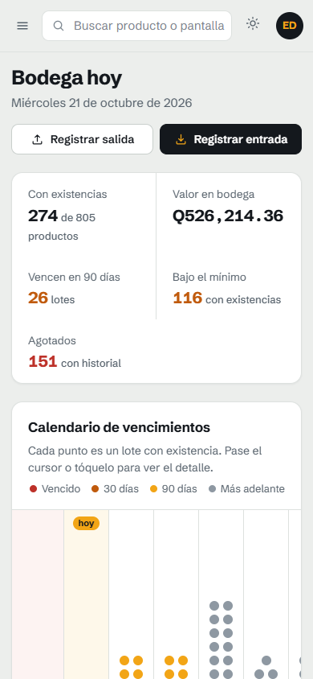

**¿Se puede usar con fondo oscuro?**
Sí. El botón del sol o la luna, en la barra superior, cambia entre tema claro y oscuro, y el navegador lo recuerda.

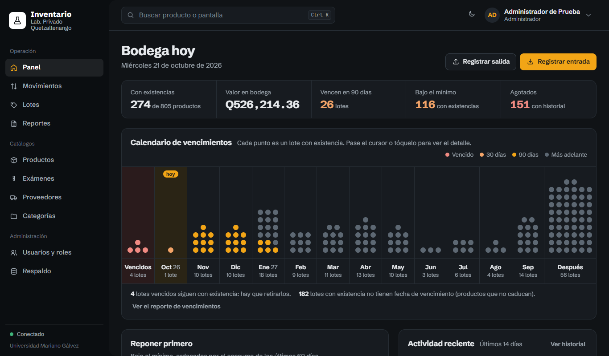
